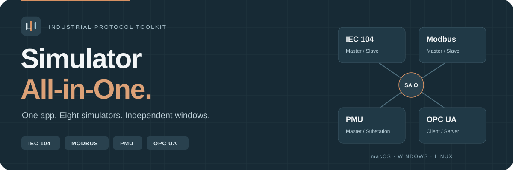
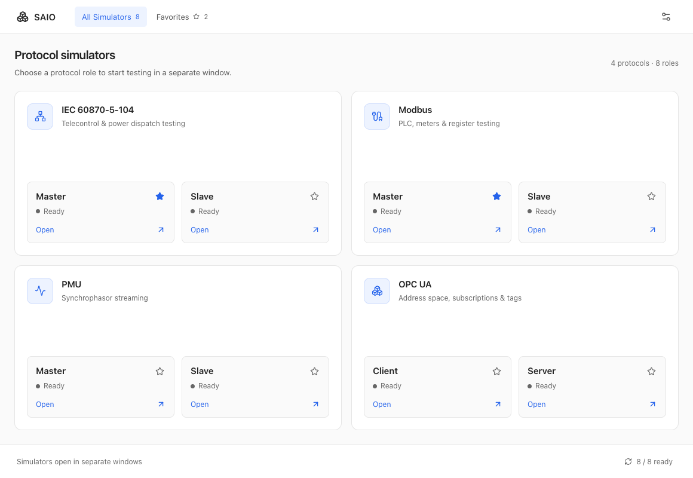
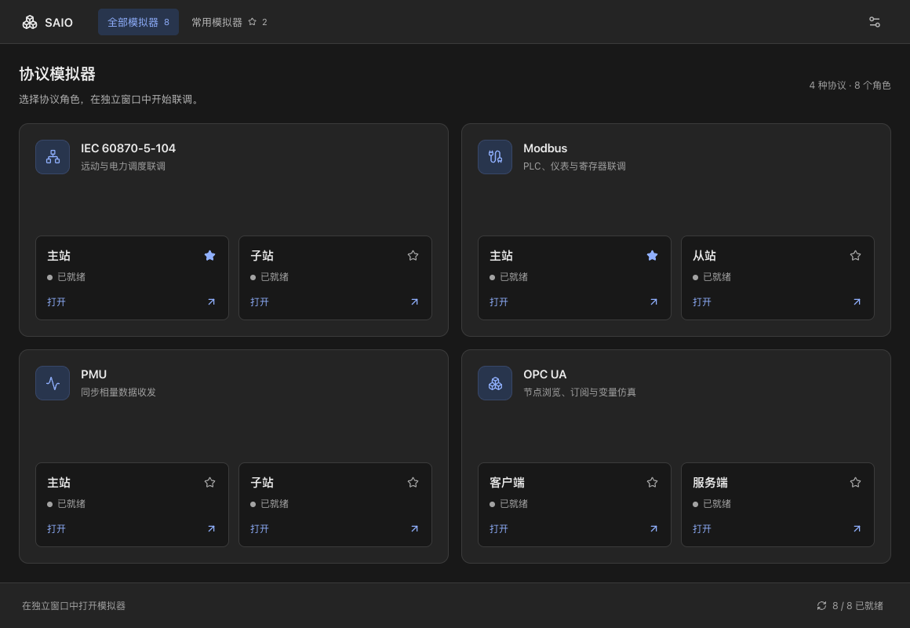

<p align="center">
  
</p>

<p align="center">
  <a href="https://github.com/Karl-Dai/Simulator-All-in-One/releases/latest"></a>
  <a href="https://github.com/Karl-Dai/Simulator-All-in-One/releases"></a>
  <a href="https://github.com/Karl-Dai/Simulator-All-in-One/actions/workflows/build-suite.yml"></a>
  
</p>

<p align="center">
  <strong>English</strong> · <a href="README.zh-CN.md">简体中文</a>
</p>

<p align="center">
  <a href="#download">Download</a> &nbsp;·&nbsp; <a href="#preview">Preview</a> &nbsp;·&nbsp; <a href="#simulators">Simulators</a> &nbsp;·&nbsp; <a href="#development">Development</a>
</p>

---

**Your industrial protocol test bench, in one desktop suite.**

Simulator All-in-One (**SAIO**, formerly SimLab Desktop) brings IEC 60870-5-104, Modbus, PMU and OPC UA tools together. Install once, choose a role and start testing in an independent window.

<table>
<tr>
<td width="50%"><strong>8 simulators, one installation</strong><br />All four protocol pairs are bundled. No separate component downloads.</td>
<td width="50%"><strong>Independent windows</strong><br />Run several roles side by side. Children keep running when the launcher closes.</td>
</tr>
<tr>
<td><strong>A launcher that fits your workflow</strong><br />Favorites, launch feedback, responsive layout, light and dark themes.</td>
<td><strong>English &amp; 简体中文</strong><br />Choose your language or follow the system. Preferences persist between sessions.</td>
</tr>
</table>

## Download

**Current release: [v0.1.3](https://github.com/Karl-Dai/Simulator-All-in-One/releases/tag/v0.1.3)** · Every package includes the launcher and all eight simulators.

| Platform | Download | Requirements |
| --- | --- | --- |
| **macOS · Apple Silicon** | [DMG](https://github.com/Karl-Dai/Simulator-All-in-One/releases/download/v0.1.3/SAIO_0.1.3_darwin-arm64.dmg) · [ZIP](https://github.com/Karl-Dai/Simulator-All-in-One/releases/download/v0.1.3/SAIO_0.1.3_darwin-arm64.zip) | macOS 13.0+ · arm64 |
| **macOS · Intel** | [DMG](https://github.com/Karl-Dai/Simulator-All-in-One/releases/download/v0.1.3/SAIO_0.1.3_darwin-amd64.dmg) · [ZIP](https://github.com/Karl-Dai/Simulator-All-in-One/releases/download/v0.1.3/SAIO_0.1.3_darwin-amd64.zip) | macOS 13.0+ · x86_64 |
| **Windows · x64** | [Offline installer](https://github.com/Karl-Dai/Simulator-All-in-One/releases/download/v0.1.3/SAIO_0.1.3_windows-amd64-setup.exe) | Bundled WebView2 offline installer |
| **Linux · x64** | [Self-extracting archive](https://github.com/Karl-Dai/Simulator-All-in-One/releases/download/v0.1.3/SAIO_0.1.3_linux-amd64.run) | Ubuntu 22.04 baseline · glibc 2.35+ |

[Release notes](https://github.com/Karl-Dai/Simulator-All-in-One/releases/tag/v0.1.3) · [SHA256SUMS](https://github.com/Karl-Dai/Simulator-All-in-One/releases/download/v0.1.3/SHA256SUMS) · [Changelog](CHANGELOG.md)

1. Download the package for your platform and verify its checksum.
2. Install the suite. On macOS, drag **Simulator All-in-One.app** into Applications.
3. Open **SAIO**, select a protocol and launch the roles you need.

> [!NOTE]
> macOS packages currently use ad-hoc signatures and are not notarized. If macOS blocks the app, review it in **System Settings → Privacy & Security**. Linux still requires a display server and compatible graphics drivers.

<details>
<summary><strong>Installation, repair and updates</strong></summary>

- **Windows:** one NSIS installer includes all eight payloads and a SHA256-verified offline WebView2 installer. It installs WebView2 only when missing, repairs declared files, protects unrelated files and blocks replacement while suite applications are running.
- **Linux:** the archive includes GTK3/WebKitGTK 4.1, verifies its contents and extracts to a stable version directory under `${XDG_DATA_HOME:-$HOME/.local/share}/SimLab/versions/`. It does not require FUSE. The host provides glibc, the display server and graphics/EGL/GLX drivers.
- **Updates:** bundled simulators do not independently update themselves. Version 0.1.3 does not automatically download and replace the complete suite.

</details>

## Preview



*Light theme · English · Launcher rendered from the application source with demo data.*

<details>
<summary><strong>Dark theme · 简体中文</strong></summary>



*The same launcher in dark mode. Preview images demonstrate the UI; they are not native protocol acceptance evidence.*

</details>

## Simulators

Four protocols, paired roles, separate processes and windows. Component versions are pinned independently of the suite version.

| Protocol | Included applications | Roles | Component version |
| --- | --- | --- | --- |
| **IEC 60870-5-104** | [IEC104Master · IEC104Slave](https://github.com/Karl-Dai/IEC60870-5-104-Simulator) | Master / Slave | `1.15.22` |
| **Modbus** | [ModbusMaster · ModbusSlave](https://github.com/Karl-Dai/ModbusSim) | Master / Slave | `0.17.9` |
| **PMU V2 / V3** | [PmuSim · PmuSub](https://github.com/Karl-Dai/PmuSim) | Master / Substation | `0.13.2` |
| **OPC UA** | [OPCUAMaster · OPCUAServer](https://github.com/Karl-Dai/OPCUASim) | Client / Server | `0.8.0` |

Each role has its own suite data directory. Projects, connection settings and certificates keep the original applications' semantics; closing the launcher does not delete them.

## Release checks

All four targets passed the [v0.1.3 native build](https://github.com/Karl-Dai/Simulator-All-in-One/actions/runs/41967403951). The [release workflow](https://github.com/Karl-Dai/Simulator-All-in-One/actions/runs/41974642759) checked the tagged source and all six archive checksums before publication.

| Target | Automated checks passed |
| --- | --- |
| **macOS · ARM & Intel** | Native compilation, backend tests, complete resource manifests, nested signatures and DMG/ZIP packaging |
| **Windows · x64** | Build, installation, repair, directory protection, nine-process startup and uninstall |
| **Linux · x64** | Build, runtime dependency audit, packaging and offline clean-container startup |

Full cross-platform GUI/protocol acceptance, a clean Windows offline first installation without WebView2, macOS 13 hardware validation and Apple notarization remain open. See the [dated evidence and limits](docs/implementation-status.md).

## Development

Build native bundles from pinned upstream commits, reviewed suite patches and a shared toolchain lock. The standalone upstream repositories remain untouched.

<details>
<summary><strong>Build from source, package layout and CI commands</strong></summary>

Build tools are pinned in [`toolchain.lock.json`](toolchain.lock.json). Use the selected Python interpreter to check your environment before building:

```sh
python scripts/toolchain.py check
```

The checker reports missing or mismatched tools without changing your installation. CI reads the same version file and remains manual-only. Build receipts and the suite manifest retain the observed tool versions, native environment details and configuration digest; a changed toolchain requires a new native build. These pinned versions passed the four-target v0.1.3 build; detailed provenance is recorded in the implementation status document.

Shared appearance contracts and Vue components live in `ui/`. ModbusMaster and IEC104Master are the initial integration targets; the remaining roles retain the legacy theme entry point. Suite language changes apply to the current session without overwriting standalone language preferences. Shared files are exported and checked by `scripts/sync_ui.py`; edit the source in `ui/` and regenerate the reviewed suite patches rather than editing generated copies.

Use the exact build-tool versions in `toolchain.lock.json`; the bootstrap scripts themselves require Python 3.10+. macOS requires Xcode Command Line Tools; Windows requires Visual Studio C++ tools, Git Bash and NSIS; Linux requires GTK3/WebKitGTK 4.1 development packages. The Wails CLI remains pinned to **v2.14.0**.

```sh
git clone https://github.com/Karl-Dai/Simulator-All-in-One.git
cd Simulator-All-in-One
go install github.com/wailsapp/wails/v2/cmd/wails@v2.14.0
python3 scripts/suite.py bootstrap
python3 scripts/suite.py build --platform darwin --arch arm64
python3 scripts/suite.py collect --platform darwin --arch arm64
python3 scripts/suite.py verify --platform darwin --arch arm64
python3 scripts/suite.py package --platform darwin --arch arm64
```

Build each target on its native platform and architecture. Replace `--platform` / `--arch` with `darwin` / `amd64`, `windows` / `amd64` or `linux` / `amd64` as appropriate. On Linux, run runtime collection and audit before packaging:

```sh
python3 packaging/linux/runtime.py prepare dist/staging/linux-amd64
python3 packaging/linux/runtime.py audit dist/staging/linux-amd64
```

`components.lock.json` pins all four upstream commits, component versions, suite patches and Rust lockfiles. npm builds use lockfiles and `npm ci`; Rust builds use `--locked`. `bootstrap` refuses dirty component checkouts rather than resetting them. For another workspace, use the same absolute `--workspace` path for every command. On Windows, keep that path short (for example `D:/s`) for `bootstrap`, `build` and `collect`, to avoid vendored OpenSSL compiler path limits. Do not bootstrap an existing manually adapted `.components/` tree again.

`collect` requires all eight roles and valid source/build receipts. macOS children are signed before their final hashes are written, and the outer app is signed separately. `SIMLAB_SIGNING_IDENTITY` or `--signing-identity` selects an existing identity; notarization is not part of this pipeline. Byte-for-byte reproducibility across compilers or OS images is not promised.

```text
dist/staging/darwin-arm64/Simulator All-in-One.app/Contents/
  Helpers/<Product>.app
  Resources/suite-manifest.json

dist/staging/windows-amd64/
  SAIO.exe
  suite-manifest.json
  apps/<role>/

dist/staging/linux-amd64/
  SAIO
  suite-manifest.json
  apps/<role>/
  runtime/
  run-simlab.sh
```

## Checks and CI

```sh
go test -race ./internal/suite
go vet ./internal/suite
python3 -m unittest discover -s scripts/tests -v
python3 -m py_compile scripts/*.py packaging/linux/runtime.py
sh -n packaging/linux/run-simlab.sh packaging/linux/self-extract.sh
actionlint .github/workflows/*.yml
cd frontend
npm ci
npm test
npm run build
```

All workflows are started manually (`workflow_dispatch`); validation and native builds can also be called by the release workflow. Pushes, pull requests, tags and schedules do not start CI. After pushing an annotated version tag, run `release.yml` on that tag to validate, build all four targets and publish their packages.

`validate.yml` checks the launcher and packaging. `build-suite.yml` builds macOS ARM/Intel, Windows x64 and Ubuntu 22.04 x64, verifies complete bundles, uploads artifacts and runs available native startup/installer checks. `validate-package.yml` only reuses trusted compatible packages; changes to compiled inputs require a full rebuild. An uploaded artifact or surviving process alone does not prove complete GUI or protocol acceptance.

See [implementation and acceptance evidence](docs/implementation-status.md) and the [Chinese build and packaging guide](README.zh-CN.md) for detailed platform constraints, pinned offline WebView2 distribution and runtime closure handling.

</details>

<details>
<summary><strong>User data, product rename and compatibility</strong></summary>

The public product name, About screens, repository and new executable/package names use **Simulator All-in-One / SAIO**. The Go module is `github.com/Karl-Dai/Simulator-All-in-One`.

Compatibility identities remain unchanged: the `SimLab` user-data directory, `SIMLAB_*` environment variables, `cloud.carldai.simlab*` bundle IDs, `simlab-suite` build feature, Windows installation/uninstall registry paths, and `.simlab-owned` marker. Existing projects, certificates, favorites and saved language choices continue to use their current locations. The Windows checker accepts both the legacy `SimLab.exe` and the new `SAIO.exe`; new installers replace the legacy Start Menu shortcut.

Historical records and existing artifacts retain their original names. Original standalone simulator repositories are not modified by suite builds; exact upstream commits and suite patches are used in isolated component checkouts.

</details>

## Documentation

| Resource | Contents |
| --- | --- |
| [Changelog](CHANGELOG.md) | Bilingual release history |
| [Implementation & acceptance](docs/implementation-status.md) | Build provenance, dated checks and remaining work |
| [Suite architecture](docs/brainstorm/2026-10-22-simulator-hub-app-design.md) | Launcher and independent application design |
| [Shared UI](docs/ui-unification.md) | Appearance and component integration |
| [Component lock](components.lock.json) · [Toolchain lock](toolchain.lock.json) | Exact upstream revisions and build tools |

---

<p align="center"><strong>One installer. Eight simulators. Independent windows.</strong><br /><a href="https://github.com/Karl-Dai/Simulator-All-in-One/releases">Get SAIO</a> · <a href="https://github.com/Karl-Dai/Simulator-All-in-One/issues">Report an issue</a> · <a href="README.zh-CN.md">简体中文</a></p>
