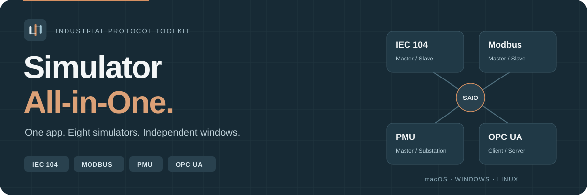
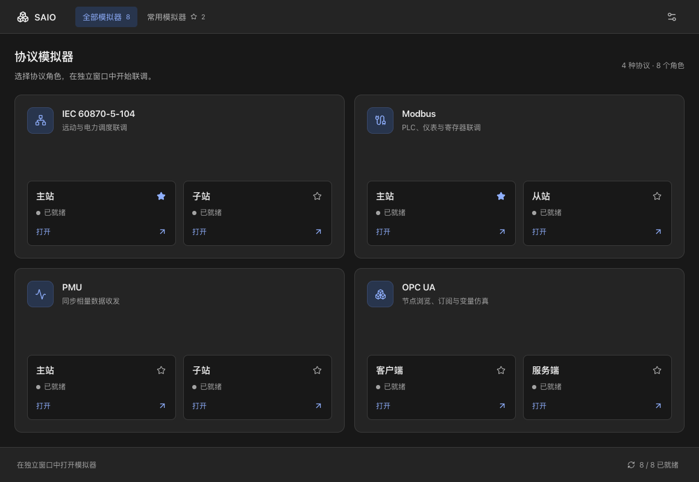
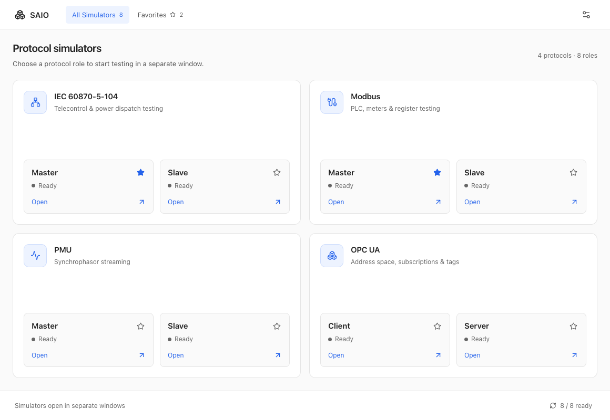

<p align="center">
  
</p>

<p align="center">
  <a href="https://github.com/Karl-Dai/Simulator-All-in-One/releases/latest"></a>
  <a href="https://github.com/Karl-Dai/Simulator-All-in-One/releases"></a>
  <a href="https://github.com/Karl-Dai/Simulator-All-in-One/actions/workflows/build-suite.yml"></a>
  
</p>

<p align="center">
  <a href="README.md">English</a> · <strong>简体中文</strong>
</p>

<p align="center">
  <a href="#下载">下载</a> &nbsp;·&nbsp; <a href="#界面预览">界面预览</a> &nbsp;·&nbsp; <a href="#协议与组件">协议与组件</a> &nbsp;·&nbsp; <a href="#开发与构建">开发与构建</a>
</p>

---

**把常用工业协议模拟器，装进同一个桌面工具箱。**

Simulator All-in-One（**SAIO**，原 SimLab Desktop）集成 IEC 60870-5-104、Modbus、PMU 和 OPC UA 工具。一个应用，选择角色，即可在独立窗口开始测试。

<table>
<tr>
<td width="50%"><strong>一个应用，八个模拟器</strong><br />四组协议工具完整内置，无需分别下载组件。</td>
<td width="50%"><strong>独立窗口，并行联调</strong><br />多个角色可同时运行，关闭主入口后子程序继续运行。</td>
</tr>
<tr>
<td><strong>常用工具，随手打开</strong><br />收藏、启动反馈、自适应布局，以及明暗主题。</td>
<td><strong>中文与英文界面</strong><br />手动选择语言或跟随系统，下次启动保留偏好。</td>
</tr>
</table>

## 下载

**当前版本：[v0.1.4](https://github.com/Karl-Dai/Simulator-All-in-One/releases/tag/v0.1.4)** · 每份安装包都包含入口和全部八个模拟器。

| 平台 | 下载 | 运行要求 |
| --- | --- | --- |
| **macOS · Apple Silicon** | [DMG 安装包](https://github.com/Karl-Dai/Simulator-All-in-One/releases/download/v0.1.4/SAIO_0.1.4_darwin-arm64.dmg) · [ZIP 归档](https://github.com/Karl-Dai/Simulator-All-in-One/releases/download/v0.1.4/SAIO_0.1.4_darwin-arm64.zip) | macOS 13.0+ · arm64 |
| **macOS · Intel** | [DMG 安装包](https://github.com/Karl-Dai/Simulator-All-in-One/releases/download/v0.1.4/SAIO_0.1.4_darwin-amd64.dmg) · [ZIP 归档](https://github.com/Karl-Dai/Simulator-All-in-One/releases/download/v0.1.4/SAIO_0.1.4_darwin-amd64.zip) | macOS 13.0+ · x86_64 |
| **Windows · x64** | [v0.1.4 安装包](https://github.com/Karl-Dai/Simulator-All-in-One/releases/download/v0.1.4/SAIO_0.1.4_windows-amd64-setup.exe) | 已发布的旧格式；后续构建使用便携 EXE |
| **Linux · x64** | [自解压安装包](https://github.com/Karl-Dai/Simulator-All-in-One/releases/download/v0.1.4/SAIO_0.1.4_linux-amd64.run) | 以 Ubuntu 22.04 为基准 · glibc 2.35+ |

[发布说明](https://github.com/Karl-Dai/Simulator-All-in-One/releases/tag/v0.1.4) · [SHA256 校验表](https://github.com/Karl-Dai/Simulator-All-in-One/releases/download/v0.1.4/SHA256SUMS) · [更新记录](CHANGELOG.md)

1. 下载对应平台的安装包，核对 SHA256 校验值。
2. 安装套件；macOS 用户将 **Simulator All-in-One.app** 拖入“应用程序”。
3. 打开 **SAIO**，选择协议，再打开需要的主站、从站或服务端。

> [!NOTE]
> macOS 安装包目前使用 ad-hoc 签名，尚未完成 Apple 公证。若系统拦截，请在“系统设置 → 隐私与安全性”中确认。Linux 仍需要显示服务和兼容的显卡驱动。

<details>
<summary><strong>安装、修复与更新说明</strong></summary>

- **Windows：** 后续构建使用单个便携 EXE，内置入口和八个模拟器。WebView2 是独立的一次性依赖，缺少时会提示下载。
- **Linux：** 包含 GTK3 / WebKitGTK 4.1，先校验文件再解压到 `${XDG_DATA_HOME:-$HOME/.local/share}/SimLab/versions/` 下的稳定版本目录，无需 FUSE。系统负责提供 glibc、显示服务和图形驱动。
- **更新：** 套件内的子程序随整个套件更新，关闭各自的独立更新入口。0.1.3 尚未实现自动下载并替换完整套件。

</details>

## 界面预览



*深色主题 · 简体中文 · 使用应用前端源码和演示数据渲染。*

<details>
<summary><strong>浅色主题 · English</strong></summary>



*同一个入口的浅色主题。图片用于展示界面，不作为原生窗口或协议验收证据。*

</details>

## 协议与组件

四种协议、八个角色，各自使用独立进程和窗口。内置模拟器统一使用 SAIO 版本，随套件一起更新。上游版本和源码提交仅用于诊断与复现构建。

| 协议 | 内置程序 | 角色 |
| --- | --- | --- |
| **IEC 60870-5-104** | [IEC104Master · IEC104Slave](https://github.com/Karl-Dai/IEC60870-5-104-Simulator) | 主站 / 子站 |
| **Modbus** | [ModbusMaster · ModbusSlave](https://github.com/Karl-Dai/ModbusSim) | 主站 / 从站 |
| **PMU V2 / V3** | [PmuSim · PmuSub](https://github.com/Karl-Dai/PmuSim) | 主站 / 子站 |
| **OPC UA** | [OPCUAMaster · OPCUAServer](https://github.com/Karl-Dai/OPCUASim) | 客户端 / 服务端 |

每个角色使用独立的套件数据目录。工程、连接参数和证书沿用原应用语义，关闭主入口不会删除这些数据。

## 发布验证

v0.1.3 的四个目标均通过[原生构建](https://github.com/Karl-Dai/Simulator-All-in-One/actions/runs/41967403951)。[发布任务](https://github.com/Karl-Dai/Simulator-All-in-One/actions/runs/41974642759)在公开安装包前，核对了 tag 提交和六份归档的 SHA256。

| 目标 | 已通过的自动检查 |
| --- | --- |
| **macOS · ARM 与 Intel** | 原生编译、后端测试、完整资源清单、嵌套签名和 DMG / ZIP 打包 |
| **Windows · x64** | 构建、安装、修复、目录保护、九进程启动及卸载 |
| **Linux · x64** | 构建、运行时依赖审计、打包及干净容器断网启动 |

全平台完整窗口和协议操作、无 WebView2 的干净 Windows 断网首装、macOS 13 实机及 Apple 公证仍待补齐。详细证据与边界见[实施记录](docs/implementation-status.md)。

## 开发与构建

构建使用锁定的上游提交、经过审阅的套件补丁和统一工具链。原独立版仓库保持原样。

<details>
<summary><strong>源码构建、打包和工作流</strong></summary>

构建工具版本集中在 [工具链配置](toolchain.lock.json)。先使用配置指定的 Python 解释器检查本机环境：

```sh
python scripts/toolchain.py check
```

检查器会说明缺少或不匹配的工具，不修改本机安装。CI 读取同一份版本配置，继续保持手动触发。
构建记录与套件清单保存实际工具版本、原生环境和配置摘要。工具链改变后需要重新进行原生构建。
这组精确版本已通过 v0.1.3 四目标构建，来源与验收记录见实施记录。

公共外观接口与 Vue 组件维护在 `ui/`。首批接入的是 ModbusMaster 和 IEC104Master，其余角色继续使用旧主题入口。
套件语言只覆盖当前会话，不写回独立版原有语言偏好。
`scripts/sync_ui.py` 负责导出和检查公共文件；修改公共源后，重新生成已审阅的套件补丁。

`components.lock.json` 锁定四个上游提交、来源版本、角色、构建位置及补丁：

| 上游 | 锁定提交 |
|---|---|
| [ModbusSim](https://github.com/Karl-Dai/ModbusSim) | `cb7654b0b1781abd342fae65db3ed8aead388c0d` |
| [IEC104](https://github.com/Karl-Dai/IEC60870-5-104-Simulator) | `d9355e9dadfa8d6ab7b0d0666788bc7fa745a6cd` |
| [PmuSim](https://github.com/Karl-Dai/PmuSim) | `483661acf89dee3362a97928c78f7e1a2ca8a9f9` |
| [OPCUASim](https://github.com/Karl-Dai/OPCUASim) | `d05cf5ef398c55955862e71874faa7321f31e87e` |

三个 Rust workspace 的依赖锁快照位于 `packaging/locks/`，校验值写入组件锁；构建使用 `--locked`。前端使用各仓库的 npm lockfile 和 `npm ci`。Wails CLI 固定为 **v2.14.0**。构建步骤可重复执行，未承诺不同编译器或系统镜像之间的产物字节完全相同。

构建时使用 `toolchain.lock.json` 中的精确工具版本；引导脚本本身要求 Python 3.10+。
另外需要 Git 和对应平台的原生工具。macOS 需要 Xcode Command Line Tools；Windows 需要 Visual Studio C++ 工具和 Git Bash；运行时需要单独安装 WebView2；Linux 需要 GTK3 / WebKitGTK 4.1 开发包和运行时资源。

在全新检出中执行：

```sh
go install github.com/wailsapp/wails/v2/cmd/wails@v2.14.0
python3 scripts/suite.py bootstrap
python3 scripts/suite.py build --platform darwin --arch arm64
python3 scripts/suite.py collect --platform darwin --arch arm64
python3 scripts/suite.py verify --platform darwin --arch arm64
python3 scripts/suite.py package --platform darwin --arch arm64
```

`bootstrap` 浅拉取精确提交，只向干净、未适配的 checkout 严格应用补丁；不 reset、clean、覆盖未知脏源码。适配后记录补丁和源码指纹，后续构建发现外部修改即停止。本轮已有人工适配的 `.components` 快照不应再次 bootstrap；需要重新构建时，使用全新的绝对路径工作目录，并给各命令传相同的 `--workspace /absolute/path`。Windows 推荐使用 `D:/s` 这样的短路径，避免 OpenSSL 生成文件超出编译器路径限制。

`build` 要求原生平台及架构，构建八个 payload 和入口，记录宿主来源/版本以及完整 payload 树的收据。`collect` 必须取得八个角色，核对收据、身份、架构和资源；缺少任一角色直接失败。`--adopt-existing` 仅用于本轮已审阅的 macOS 初始产物，要求上游 HEAD、整个补丁及子应用 bundle ID / 版本匹配，不是普通构建的默认旁路。

macOS 收集顺序为子应用内部签名 → 子应用签名 → 计算最终哈希 → 写 manifest → 单独签外层应用；外层签名不使用 `--deep` 重签子应用。默认 ad-hoc，`--signing-identity` / `SIMLAB_SIGNING_IDENTITY` 可提供构建机器上已有的身份；公证不包含在当前管线。

```text
dist/staging/darwin-arm64/Simulator All-in-One.app/Contents/
  Helpers/<Product>.app
  Resources/suite-manifest.json

dist/staging/windows-amd64/
  SAIO.exe
  suite-manifest.json
  apps/<role>/<executable, DLLs and resources>

dist/staging/linux-amd64/
  SAIO
  suite-manifest.json
  apps/<role>/<executable and resources>
  lib/
  runtime/usr/
  runtime/closure.json
  run-simlab.sh
```

## Windows 与 Linux 打包

Windows 构建现在生成 `SAIO_<version>_windows-amd64-portable.exe`。下载一个 EXE，双击即可打开主入口和内置八个模拟器。SAIO 无需安装，不请求管理员权限、不创建快捷方式或卸载项。首次启动将经过校验的程序解压到 `%LOCALAPPDATA%\SAIO\portable\<payload-hash>`，之后重复使用缓存。缓存缺失时重新解压；损坏时先保留旧目录再修复，工程保存在 `%APPDATA%\SimLab`。

**Windows 运行依赖：Microsoft Edge WebView2 运行库。** SAIO 不捆绑或静默安装运行库。缺少运行库或版本过旧时，程序会通过原生 Windows 提示框询问是否打开 [SimLab WebView2 下载页面](https://simlab.carldai.cloud/downloads/webview2/)，取消后正常退出。安装一次运行库后重新打开 SAIO 即可。离线电脑可先在其他电脑下载 x64 离线安装包，再拷贝过去安装。也可使用[微软官方下载页面](https://developer.microsoft.com/en-us/microsoft-edge/webview2/)。

运行 `python scripts/suite.py package --platform windows --arch amd64` 即可生成便携包。需要锁定的 Go 工具链和 `MinGW` 提供的 `windres.exe`，后者须在 `PATH` 中；原生 Windows CI 已提供 `MinGW`。WebView2 独立托管，来源及 SHA-256 记录在 `packaging/windows/webview2.lock.json`。已发布的 v0.1.4 安装包保持原样，后续发布改用便携 EXE。

Linux 构建机固定为 Ubuntu 22.04 amd64；Wails 显式使用 `webkit2_41`。安装依赖可参考工作流的 apt 列表，然后执行：

```sh
python3 scripts/suite.py build --platform linux --arch amd64
python3 scripts/suite.py collect --platform linux --arch amd64
python3 packaging/linux/runtime.py prepare dist/staging/linux-amd64
python3 packaging/linux/runtime.py audit dist/staging/linux-amd64
python3 scripts/suite.py package --platform linux --arch amd64
```

运行时收集包括 WebKitWebProcess、WebKitNetworkProcess、注入 bundle、GTK/GIO/Pixbuf 模块、字体、所声明的沙箱工具和 GStreamer scanner，并递归收集 ELF 依赖。WebKit helper 路径采用 [Tauri 官方 GTK 打包器的等长重定位方法](https://github.com/tauri-apps/tauri/blob/dev/crates/tauri-bundler/src/bundle/linux/appimage/linuxdeploy-plugin-gtk.sh)，入口和子程序的 Linux cwd 固定为 `runtime/usr`；不依赖发行版忽略的 `WEBKIT_EXEC_PATH`，也不关闭 WebKit sandbox。相对外部文件路径因此以该目录解析，配置中应使用可访问的绝对证书路径。

缺少任何必要工具、运行时资源、闭包记录，存在未声明宿主库，或 glibc 要求高于所声明最低版本时，打包明确失败。静态闭包不能证明所有运行行为，因此工作流另用没有安装 GTK/WebKit 的 Ubuntu 容器，在 `--network none` 下启动检查。

## 验证与工作流

```sh
python3 -m unittest discover -s scripts/tests -v
python3 -m py_compile scripts/*.py packaging/linux/runtime.py
sh -n packaging/linux/run-simlab.sh packaging/linux/self-extract.sh
actionlint .github/workflows/*.yml
```

v0.1.3 发布前通过 66 项 Python 测试，覆盖以下场景：

- 脏源码保护、缺角色保留旧目录、签名与哈希顺序、完整资源树和清单路径。
- Wails 应用元数据、自解压缺文件修复、旧目录保留及 Windows 的 Git Bash 选择。
- cp1252 环境下的中文配置与资源收集、独立日志读取、阶段超时和 Wayland 依赖收集。
- 原生包复用的来源与文件边界，以及工具链、共享资源和发布校验。

macOS DMG 已通过 `hdiutil verify`。整套 `.app` 已通过 `codesign --verify --deep --strict`。

所有工作流均由手动触发（`workflow_dispatch`）；发布流程也可调用源码检查和原生构建。推送、PR、标签和定时任务都不会自动启动 CI；需要时在 GitHub Actions 中明确运行对应工作流。

`validate.yml` 执行源码及打包静态检查；`build-suite.yml` 使用 macOS arm64 / x64、Windows x64、Ubuntu 22.04 x64 原生 runner，构建全部组件并上传完整套件。`target` 默认 `all`，也可选择一个原生目标，独立重跑失败的平台。Windows job 生成内置八个模拟器的单个便携 EXE，发布包不捆绑 WebView2；CI 单独安装测试运行依赖，原生检查覆盖缓存复用、修复和启动。

`validate-package.yml` 可对同一仓库已完成的 `main` 原生构建复验。脚本核对来源、祖先提交、安装包校验值和八角色完整清单；应用代码、补丁、锁文件或构建脚本变化会拒绝复用。Windows 只恢复清单内的原始 payload，并用当前便携包脚本重新打包；Linux 仅复验原 `.run`，运行时内容变化必须完整重建。产物携带来源与本轮验证提交记录。复用沿用来源 run 的编译环境；调整构建工作流的编译参数或工具链后，应运行完整原生构建。

Rust 缓存保留失败任务的编译结果。完整包在运行验收之前上传，便于检查失败产物；可下载产物不代表该任务已通过。Linux 解压、虚拟显示与启动检查有阶段日志和超时限制。

Windows 工作流安排隔离目录安装、缺组件修复、未知文件保护、活动实例禁止替换、启动和卸载测试；runner 可能预装 WebView2，因此这仍不能替代“无 WebView2 的干净 Windows 断网首次安装”验收。Linux 工作流安排无宿主 GTK/WebKit 的断网容器启动检查。`smoke.py` 只验证进程启动存活和已知依赖错误，不代表完整 UI、真实设备或协议一致性验收。各平台结果在[实施记录](docs/implementation-status.md)中按实际证据记录。

</details>

<details>
<summary><strong>用户数据、改名和兼容性</strong></summary>

入口和八个子程序统一把配置写入用户数据根目录的 `saio.db`（SQLite）。启动器传递绝对 `SIMLAB_DATA_DIR`，默认位于系统用户配置目录下的 `SimLab`。配置修改自动保存，重开恢复配置后保持连接和服务停止。旧自动保存文件和界面设置仅首次迁移，原文件保留。手动工程副本统一使用 `.saioproj`，继续支持原工程格式导入。详见[配置保存说明](docs/configuration-storage.md)。

组件的 WebView、OPC UA PKI、证书等资源仍按角色隔离。macOS WKWebView 网站数据使用各自的套件 bundle ID，Windows WebView2、Linux XDG 数据路径采用组件隔离目录。外部证书和回放文件保留路径引用。

套件子程序关闭独立更新及相应下载入口，版本随整个套件交付。首版未实现自动下载并替换套件。用户选择的工程、证书和连接参数不会因为关闭主入口而被删除。

### 改名与兼容性

显示名称、About、仓库链接和新构建产物统一使用 Simulator All-in-One / SAIO。Go 模块地址为 `github.com/Karl-Dai/Simulator-All-in-One`。

用户数据目录 `SimLab`、`SIMLAB_*` 环境变量、`cloud.carldai.simlab*` 应用标识及 `simlab-suite` 构建特性保持兼容。现有工程、证书、收藏和语言选择会继续使用。Windows 便携包单独保存程序缓存，不创建卸载注册表键或开始菜单快捷方式；旧安装包校验脚本继续保留，供历史版本使用。

历史构建和验收记录继续使用当时的名称与文件名，旧的 `SimLab_*` 安装包不包含此次改名。

</details>

## 项目文档

| 文档 | 内容 |
| --- | --- |
| [更新记录](CHANGELOG.md) | 中英双语版本历史 |
| [实施与验收](docs/implementation-status.md) | 构建来源、历次验证及未完成项 |
| [套件架构](docs/brainstorm/2026-10-22-simulator-hub-app-design.md) | 入口与独立子程序的设计 |
| [共享界面](docs/ui-unification.md) | 外观与组件接入 |
| [组件锁](components.lock.json) · [工具链锁](toolchain.lock.json) | 精确源码提交和构建工具版本 |

---

<p align="center"><strong>一个应用，八个模拟器，独立窗口。</strong><br /><a href="https://github.com/Karl-Dai/Simulator-All-in-One/releases">下载 SAIO</a> · <a href="https://github.com/Karl-Dai/Simulator-All-in-One/issues">反馈问题</a> · <a href="README.md">English</a></p>
