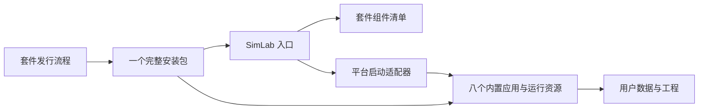

# 模拟器完整桌面套件设计

**Status:** Approved

日期：2026-10-22
暂用产品名：**SimLab Desktop**。
已确认需求：一个完整软件自带全部模拟器，安装后点击即用，打开各自独立窗口；首版覆盖 Windows、macOS、Linux。
审阅状态：用户明确确认完整套件、独立窗口和三平台范围，并于 2026-10-22 指示“开干”，据此按当前草案开始实施。名称、技术栈、具体系统版本与 CPU 架构为下文的建议默认值。

## 1. 产品目标与成功标准

用户只下载并安装一次对应系统的完整套件。打开 SimLab 后，可直接打开 IEC104、Modbus、PMU、OPC UA 的全部八个角色应用，无需再下载、安装或绑定任何一个模拟器。安装机器上预先没有这些模拟器，也应能使用。

主入口和模拟器各自拥有独立窗口。套件启动时只加载入口，用户点击某个角色后才运行对应程序。所有程序、必要资源及可分发运行库随套件提供；在明确支持的系统环境中，安装后的首次使用不需要联网。

首版同时交付三个系统的完整包。每个平台都以干净环境中断网安装、八个角色首次启动并完成基本操作作为验收要求，构建成功不等于该平台已通过验收。

## 2. 已核实的项目基础

以下版本是本次调研时的最新发布快照，设计不将这些版本号写死为运行时数据。

| 协议 | 独立应用 | 当前桌面技术 | 发布快照 | 更新机制 |
| --- | --- | --- | --- | --- |
| Modbus | ModbusMaster / ModbusSlave | Go、Wails 2、Vue 3 | v0.17.9，2026-10-21 | 当前 Go 版手动下载安装，提供发布清单和校验文件 |
| IEC104 | IEC104Master / IEC104Slave | Rust、Tauri 2、Vue 3 | v1.15.22，2026-10-10 | 主、从站各自的签名 updater |
| PMU | PmuSim / PmuSub | Rust、Tauri 2、Vue 3 | v0.13.2，2026-10-02 | 主站有 updater，子站当前手动下载安装 |
| OPC UA | OPCUAMaster / OPCUAServer | Rust、Tauri 2、Vue 3 | v0.8.0，2026-10-09 | 客户端、服务端各自的签名 updater |

事实来源：[Modbus README](https://github.com/Karl-Dai/ModbusSim/blob/main/README.md)、[Modbus Release](https://github.com/Karl-Dai/ModbusSim/releases/tag/v0.17.9)、[IEC104 配置](https://github.com/Karl-Dai/IEC60870-5-104-Simulator/blob/main/crates/iec104master-app/tauri.conf.json)、[IEC104 Release](https://github.com/Karl-Dai/IEC60870-5-104-Simulator/releases/tag/v1.15.22)、[PMU 主站配置](https://github.com/Karl-Dai/PmuSim/blob/main/crates/pmusim-app/tauri.conf.json)、[PMU 子站配置](https://github.com/Karl-Dai/PmuSim/blob/main/crates/pmusim-sub/tauri.conf.json)、[PMU Release](https://github.com/Karl-Dai/PmuSim/releases/tag/v0.13.2)、[OPC UA 配置](https://github.com/Karl-Dai/OPCUASim/blob/master/crates/opcuamaster-app/tauri.conf.json)、[OPC UA Release](https://github.com/Karl-Dai/OPCUASim/releases/tag/v0.8.0)。

已有 [SimLab](https://github.com/Karl-Dai/SimLab/blob/main/README.md) 网站聚合这四组协议、角色、平台、架构和安装包，并在构建时同步 GitHub Releases。完整套件可以沿用品牌与协议分类；现有网站继续承担产品展示和完整套件下载，用户使用模拟器不依赖该网站。

本次检查还发现：

- 八个应用的已查启动入口和配置中，均未发现可供外部入口统一使用的工程参数或 deep link 契约。原应用内部的 `LoadProject` / `load_config` / `load_project` 不等于跨进程接口。
- Modbus 有 `.modbusproj`；IEC104 使用区分主从角色的 JSON 配置；OPC UA 有 `.opcuaproj`；PMU 未核实到可供入口直接打开的工程格式。
- [Tls104Master](https://github.com/Karl-Dai/Tls104Master/blob/master/README.md) 已标记停止维护，不列入首批入口。GWDataSimulator、ProtoRoute 的用途未通过本次 GitHub README 查询核实，先保留为候选扩展。

启动与工程边界来源：[Modbus 启动代码](https://github.com/Karl-Dai/ModbusSim/blob/main/go/cmd/mastergui/main.go)、[Modbus 应用接口](https://github.com/Karl-Dai/ModbusSim/blob/main/go/cmd/mastergui/app.go)、[IEC104 启动与命令](https://github.com/Karl-Dai/IEC60870-5-104-Simulator/blob/main/crates/iec104master-app/src/lib.rs)、[PMU 启动入口](https://github.com/Karl-Dai/PmuSim/blob/main/crates/pmusim-app/src/main.rs)、[OPC UA 启动与恢复](https://github.com/Karl-Dai/OPCUASim/blob/master/crates/opcuamaster-app/src/lib.rs)。没有外部启动契约的结论限于已查代码，未通过真实进程启动验证。

## 3. 可选架构与推荐

| 方案 | 实现方式 | 优点 | 主要代价 |
| --- | --- | --- | --- |
| A：套件入口加内置子应用，推荐 | 一个安装包携带入口及八个经过套件适配的应用，点击后打开独立窗口 | 保留现有协议功能和开发框架；边界清楚；能集中完成安装与升级 | 需要增加套件构建模式、资源打包和统一发布验证 |
| B：统一宿主、多窗口模块 | 将八个应用层迁入统一宿主，再为每个模块创建窗口 | 桌面桥接、窗口和公共服务更一致 | 需要改造 Wails bindings、Tauri invoke、状态与生命周期，初次交付范围更大 |

采用 A。两种方案都满足“一次安装、点击即用”；本轮按已确认的完整套件、独立窗口范围实施。首版无需为未来单窗口整合设计插件系统或跨协议公共工程模型。

## 4. 用户看到的产品

首页呈现四组协议，每组两个清晰的角色按钮：IEC104 主站/子站、Modbus 主站/从站、PMU 主站/子站、OPC UA 客户端/服务端。八个入口在首次打开时即应可用。

界面保留协议说明、收藏、最近使用和套件版本。内置组件版本及来源放在“关于”详情，日常操作不要求用户理解八个二进制或不同桌面框架。默认使用中文，跟随系统浅色/深色主题。

点击后立即显示该次操作的短暂进度，启动失败显示可操作的错误。入口只能确认启动请求和可验证的进程结果；没有协议状态接口时，不显示“已连接设备”或“服务已就绪”。最终验收必须核对真正可操作的目标窗口。

安装损坏时提供修复或重新运行完整套件安装包的指引；正常使用流程没有“去下载某个模拟器”“扫描本机安装”“选择应用路径”等步骤。

最近使用记录只指应用角色。现有工程仍由各模拟器自己的打开/保存界面管理，首版不增加从入口直接打开任意工程的跨进程契约。

## 5. 架构、模块与数据流

建议采用独立套件项目 `SimLab-Desktop`，继续在四个现有仓库维护各自协议实现，并新增独立版/套件版构建配置。套件项目固定引用经过验收的源码提交及产物，不在用户首次点击时下载组件，也不运行八个子安装器。

| 组件 | 职责 | 对外边界 |
| --- | --- | --- |
| 入口界面与应用服务 | 协议分组、角色按钮、收藏、最近使用、关于和失败提示 | 只提交稳定角色 ID，不接收界面传来的任意命令 |
| 套件清单 | 定义本套件随附的八个应用及精确版本 | 提供角色、相对入口、资源目录、平台、架构、构建模式和校验信息 |
| 启动适配器 | 从当前套件位置解析目标、设置数据与运行环境并启动 | 仅启动当前套件内的固定目标，不搜索全局独立安装版 |
| 套件构建适配 | 为每个子应用提供套件身份、数据路径与更新归属 | 通过构建配置维持独立版和套件版，复用协议核心与现有 UI |
| 用户数据层 | 保存入口偏好及按角色隔离的子应用数据 | 数据位于用户目录，安装目录保持只读；工程沿用原应用语义 |
| 套件发行层 | 收集已固定版本的组件、运行库、签名及许可证说明，构建总包 | 某个必选角色缺失或校验失败时，不生成标为完整的发行包 |

入口建议继续使用 Go + Wails 2 + Vue 3 + TypeScript，与当前 Modbus 的开发链路一致；Tauri 2 + Vue 3 也是可替换的宿主方案。宿主选择不要求重写八个模拟器。SimLab 网站提供品牌、分类与文案参考，不直接作为桌面运行宿主。

启动数据流：稳定角色 ID → 读取随包清单 → 校验当前平台与包内入口 → 创建用户数据目录 → 用平台 API 启动内置程序 → 返回操作结果并记录最近使用。所有路径根据实际安装根目录解析，路径含空格或中文时也必须有效。

## 6. 三个平台的交付形态

建议的首版 CPU 架构为 Windows x64、macOS Apple Silicon 与 Intel、Linux x64。三类系统均属于已确认范围；这些架构及下述系统基线仍是待反馈的工程默认值，未承诺所有 ARM64 组合。

| 系统 | 一个完整交付物 | 内置形态及依赖处理 |
| --- | --- | --- |
| Windows | 一个套件安装器 `SimLab-Setup.exe` | 一次部署入口及八个应用目录；保留每个程序所需 DLL 和资源；随包提供 WebView2 离线安装程序，缺失时由总安装流程处理一次 |
| macOS | 一个 DMG，内含一个 `SimLab.app` | 八个完整子 `.app` 位于外层 `Contents/Helpers/` 等正规嵌套代码位置；保留各自资源及元数据；按内到外顺序签名并验证最终外层产物 |
| Linux | 一个完整离线安装包 `SimLab-linux-x64.run` | 一次解包安装到用户目录中的稳定位置并生成入口；携带八个程序、GTK/WebKitGTK 及其可分发依赖；不使用会随入口窗口退出而消失的临时挂载目录运行子应用 |

Windows 首版默认 Windows 10 22H2 / Windows 11 x64；macOS 首版最低版本为 13.0（依据本机 Go 1.27 工具链产物要求），并在最终发布说明中明确；Linux 首版默认 Ubuntu 22.04/24.04 x64 桌面环境，glibc、图形会话与显卡驱动仍属于宿主基线。实现发现更高最低要求时，需报告并更新设计，不能继续沿用未验证的兼容声明。

Linux 套件内的 Wails 程序计划统一按 WebKitGTK 4.1 构建，以便与 Tauri 2 共享同一运行库基线。当前 Modbus 已发布的 Linux 包仍依赖 WebKitGTK 4.0，不能直接视为满足本套件的离线交付要求。需要在套件模式下重建并验证动态依赖，避免靠用户安装开发环境补齐。

选择稳定安装目录而非嵌套运行八个 AppImage，是为保证关闭入口后子窗口仍可继续使用资源。Linux 安装器的实际技术可在实现时选择现成自解包工具，产品契约是一个完整包、一次安装、无需联网补组件；若打包验证无法满足该契约，应回到设计处理，不能改成点击后让用户下载子应用。

依据：[Microsoft WebView2 离线分发](https://learn.microsoft.com/en-us/microsoft-edge/webview2/concepts/distribution)、[Apple bundle 内容位置](https://developer.apple.com/documentation/bundleresources/placing-content-in-a-bundle)、[Apple 嵌套代码签名](https://developer.apple.com/library/archive/documentation/Security/Conceptual/CodeSigningGuide/Procedures/Procedures.html)、[Wails Linux 构建选项](https://wails.io/docs/gettingstarted/building/)、[Tauri Linux 兼容基线](https://v2.tauri.app/distribute/appimage/)。这些文档证明打包机制与约束，不代替本项目的实际验收。

## 7. 子应用需要的最小适配

### 套件身份与数据目录

为套件版分配独立应用标识，统一前缀建议为 `cloud.carldai.simlab`，角色后缀为 `modbus.master`、`iec104.slave` 等。入口严格按套件内具体路径启动。旧独立版保持自己的标识、卸载记录和数据，不被套件安装、升级或卸载改写。

数据目录在系统用户应用数据位置下归属于 SimLab，再按角色分开；WebView 数据、会话、预设、日志与证书均应遵循套件身份。现有单实例锁、凭据或内部控制端点若存在，也必须按套件身份区分。用户配置的协议监听端口保持原语义，冲突由对应模拟器明确报错，不通过结束旧版进程解决。

首版默认使用独立配置，不静默迁移旧安装的状态。原应用已支持的工程文件仍可手动打开；PMU 不在本轮新增工程持久化格式。用户工程里引用的外部证书路径不因套件打包而自动变成自包含资源。

### 子应用更新归属

套件构建模式必须关闭每个子应用的独立更新流程，包括前端自动检查、手动更新按钮、后端检查与安装命令、启动时执行 pending update 的任务，以及旧版更新包应用逻辑。仅隐藏弹窗或删除更新端点不算完成。

独立版继续使用现有升级方式。套件版“关于”显示组件版本；更新操作归总套件管理，不能下载独立版安装器覆盖套件内部程序。

### 可写路径与资源

安装目录保持只读。已发现 OPCUAMaster 在 GitHub `master` 的证书管理代码使用 `./pki`，而协议客户端构建未明确接入同一证书根。套件适配要同时修改证书管理与运行时路径；服务端证书目录也接入该角色的用户数据根，不能只靠设置 cwd 规避。

依据：[OPC UA 主站 PKI](https://github.com/Karl-Dai/OPCUASim/blob/master/crates/opcuamaster-app/src/commands.rs#L1523)、[客户端构建](https://github.com/Karl-Dai/OPCUASim/blob/master/crates/opcuasim-core/src/client.rs#L181)、[服务端 PKI](https://github.com/Karl-Dai/OPCUASim/blob/master/crates/opcuasim-core/src/server/server.rs#L135)、[IEC 更新实现](https://github.com/Karl-Dai/IEC60870-5-104-Simulator/blob/main/crates/iec104master-app/src/update.rs)、[PMU 主站启动](https://github.com/Karl-Dai/PmuSim/blob/main/crates/pmusim-app/src/main.rs)、[OPC UA 启动](https://github.com/Karl-Dai/OPCUASim/blob/master/crates/opcuamaster-app/src/lib.rs)。

## 8. 套件版本、升级与发布边界

用户只看到一个套件发行版本。`suite-manifest.json` 固定记录：清单格式版本、套件版本、目标系统和架构，以及八个角色的组件版本、源码提交、包内相对入口、suite 构建标记和交付文件校验信息。运行时不使用 GitHub 最新独立版来替换清单组件。

第一版升级采用完整套件新安装包，由一个总安装流程替换全部程序。入口可以提供“检查套件更新/获取新版套件”的单一入口，首次使用和普通启动不依赖它。首版不实现组件级热更新、差分更新或无人值守更新。

升级前检测仍在运行的套件程序，请用户完成保存并退出子窗口；不强制结束协议进程、不在旧进程仍运行时覆盖其文件。新版本先准备完整 payload，再由平台安装流程切换；安装失败保留可用旧版本，不能留下一半新一半旧的必选组件。macOS 替换整个外层 `.app`，不在签名完成后单独修改子 `.app`。

升级、修复和卸载均只操作套件自己的程序。修复可重新运行同版本完整安装包；默认保留用户数据。旧独立版配置不纳入套件清理。套件版不自动升级用户工程 schema，本轮也不实施跨版本数据迁移器；后续需要迁移时，必须先定义备份和失败恢复，不能默认二进制回滚就等于数据也能回滚。

发行流程在构建期获取固定源码/产物，检查目标架构、八角色完整性、依赖和签名，再生成安装包与校验文件。发布到 GitHub、签名账号配置及生产网站变更不是本次设计授权的外部操作。

## 9. 窗口生命周期与失败处理

八个应用保持独立进程；某个模拟器崩溃不结束入口或其他模拟器。关闭入口不结束已经打开的子窗口，也不清理它们仍在使用的程序与资源目录。重新打开入口后仍能使用同一套件。

同一次启动请求尚未返回时禁用该角色按钮，避免连点。用户之后再次点击时按该应用当前支持的窗口语义处理，首版不新增跨八个产品的单实例协议。对子进程状态的展示仅限能够确认的事实，不将“进程存在”视为协议服务正常。

组件缺失、校验失败、权限不足、系统运行库加载失败和进程提前退出应分别报告，并引导修复整个套件。故障角色不会自动改为启动本机独立版。其他完整角色继续可用；发布前验收则要求八个必选角色全部通过。

## 10. 验收矩阵与验证方法

| 场景 | 必须得到的结果 |
| --- | --- |
| 干净系统且无任何独立模拟器 | 安装一次完整套件，断网后八个角色均能首次打开，无二次下载和子安装器 |
| 每个角色的基本协议操作 | 在本机主从/客户端服务端闭环完成连接、读写或数据流基本操作；不要求外部设备，但不能只验证窗口外观 |
| 路径与只读安装 | 中文、空格路径可启动；应用与资源不写安装目录；PKI、预设和会话写入角色用户目录 |
| 正式版、开发版及套件版并存 | 套件始终打开自身内置程序；各自数据和升级归属隔离；协议端口占用有明确错误 |
| 子更新器抑制 | 自动启动、手动菜单及残留 pending-update 均不能下载或安装独立版更新 |
| 关闭入口、退出或崩溃子窗口 | 其他模拟器继续运行，仍可重新打开；Linux 子窗口不因入口退出而丢失运行资源 |
| 完整升级与失败恢复 | 活动窗口阻止文件替换；正常升级保留用户数据；失败后仍有完整可用旧程序 |
| 最终分发包 | Windows 校验依赖和安装路径；macOS 校验内外签名、安装/移动后启动；Linux 在声明的发行版基线完成离线运行 |

三个系统和声明的每种 CPU 架构分别报告结果；某个角色、系统或架构未实际验证时，保持该项未验收，不能据其他平台通过推定成功。当前构建与运行结果见[实施与验收记录](../implementation-status.md)。

自动化测试集中覆盖清单完整性、相对入口解析、套件身份/数据路径、更新模式切换与失败恢复；真实安装、窗口可操作性、协议闭环和系统签名必须保留运行证据。

## 11. 范围与审阅状态

本设计包含入口、八个应用的套件构建适配、三个系统的完整打包与整包版本管理。它们共同构成一次安装后的完整体验，不能把“子应用随包交付”降为后续阶段。

首版范围外：统一单窗口、公共协议后端、跨协议点表、统一工程格式、从入口直接打开最近工程、账号云同步、组件市场及组件级热更新。

已确认：完整软件随包带齐全部模拟器；点击后打开独立窗口；Windows、macOS、Linux 均为首版范围。

仍为建议默认值：产品名 SimLab Desktop；方案 A 的内部实现；Go/Wails 入口；Windows x64、macOS 双架构、Linux x64；具体最低系统版本和 Linux 安装器技术。

**本文为实施依据。实现、本地验证、创建私有仓库、提交推送及 CI 验证已获授权；正式发布和部署不属于本轮授权范围。**
